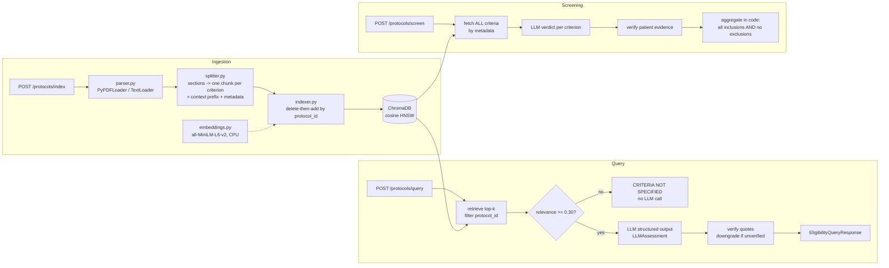

# clinical-trial-rag

A FastAPI microservice that answers eligibility questions about clinical trial protocols, and pre-screens a patient summary against every criterion of a trial. Answers are grounded in verbatim, verified protocol text.

Built with FastAPI, LangChain, ChromaDB, sentence-transformers and Pydantic v2.

> **Decision support only.** Not a validated medical device. A qualified research coordinator makes every enrolment decision. Use public or synthetic protocols and de-identified patient text only.

**New to the stack?** [`docs/STUDY_BOOK.md`](docs/STUDY_BOOK.md) is a 16-chapter guide to every concept and file in this repo, from the clinical-trials primer to the code walkthrough, evaluation and interview questions.

## Design in one paragraph

The LLM only reads text and fills a typed form. Code handles everything else:
- trial isolation (a hard `protocol_id` filter inside the vector query)
- abstention (a relevance gate that skips the LLM call)
- the fixed fallback sentence
- verbatim quote verification, which computes `is_grounded`
- the final eligible / not-eligible decision

Every response carries an audit block (model, prompt version, chunk IDs, context hash), so any answer can be traced and replayed.

## Architecture



| Endpoint | Purpose |
| --- | --- |
| `POST /api/v1/protocols/index` | Upload a `.pdf`/`.txt` protocol (`multipart/form-data`: `file`, `protocol_id`). Re-uploading replaces the old version |
| `POST /api/v1/protocols/query` | Criterion Q&A, top-k RAG with citations |
| `POST /api/v1/protocols/screen` | Check a patient summary against every inclusion/exclusion criterion |
| `GET /api/v1/protocols` | List indexed protocols |
| `DELETE /api/v1/protocols/{protocol_id}` | Remove a protocol |
| `GET /health` / `GET /ready` | Liveness / readiness |

Interactive docs: `http://localhost:8000/docs`.

## Quickstart

```bash
python3.11 -m venv .venv && source .venv/bin/activate
pip install torch==2.14.1 --index-url https://download.pytorch.org/whl/cpu
pip install -r requirements.txt
cp .env.example .env          # add OPENAI_API_KEY for LLM answers
uvicorn app:app --reload --port 8000
```

Without an API key you can still index, list and delete protocols. Queries that the relevance gate blocks still work too. Endpoints that need the LLM return `503`.

## Example requests

Index a protocol (two synthetic samples ship in `data/sample_protocols/`):

```bash
curl -X POST http://localhost:8000/api/v1/protocols/index \
  -F "file=@data/sample_protocols/NCT90000001_t2d_protocol.txt" \
  -F "protocol_id=NCT90000001"
```

```json
{"message": "Protocol indexed successfully.", "protocol_id": "NCT90000001",
 "source_filename": "NCT90000001_t2d_protocol.txt", "chunks_indexed": 21,
 "criteria_indexed": 16, "replaced_existing": false}
```

Ask a question:

```bash
curl -X POST http://localhost:8000/api/v1/protocols/query \
  -H "Content-Type: application/json" \
  -d '{"query": "Can a patient with an eGFR of 25 enroll?", "protocol_id": "NCT90000001", "top_k": 4}'
```

Response shape (LLM wording varies):

```json
{
  "protocol_id": "NCT90000001",
  "query": "Can a patient with an eGFR of 25 enroll?",
  "status": "NOT_ELIGIBLE",
  "assessment": "STATUS: NOT_ELIGIBLE\nAn eGFR of 25 is below the exclusion threshold of 30.\n\nPROTOCOL EVIDENCE:\n- [Exclusion Criteria | 3f9c...] \"eGFR) below 30 mL/min/1.73m2 at screening\" (verified)\n\nSAFETY CONCERNS:\n- Severe renal impairment is an exclusion criterion.",
  "citations": [{"source_document": "NCT90000001_t2d_protocol.txt", "protocol_id": "NCT90000001",
                 "excerpt": "Estimated glomerular filtration rate (eGFR) below 30 mL/min/1.73m2 at screening.",
                 "chunk_id": "3f9c...", "section": "Exclusion Criteria", "criterion_type": "exclusion",
                 "quote": "eGFR) below 30 mL/min/1.73m2 at screening", "quote_verified": true}],
  "is_grounded": true,
  "safety_concerns": ["Severe renal impairment is an exclusion criterion."],
  "audit": {"model": "gpt-4o-mini", "prompt_version": "qa-v1", "retrieved_chunk_ids": ["3f9c...", "..."],
            "context_hash": "9b1e...", "llm_called": true, "timestamp": "2026-10-22T08:00:00Z"}
}
```

An off-topic question (e.g. "Where should visitors park?") returns status `CRITERIA_NOT_SPECIFIED` with exactly: *"CRITERIA NOT SPECIFIED: The provided protocol documents do not contain explicit rules regarding this query."* No LLM call is made.

Screen a patient:

```bash
curl -X POST http://localhost:8000/api/v1/protocols/screen \
  -H "Content-Type: application/json" \
  -d '{"protocol_id": "NCT90000001", "patient_summary": "62-year-old man, type 2 diabetes for 8 years, metformin 2000 mg daily, HbA1c 8.1%, BMI 31, eGFR 24 mL/min/1.73m2."}'
```

This returns one verdict per criterion (`MET` / `NOT_MET` / `INSUFFICIENT_INFO`), `failing_criteria`, `unresolved_criteria`, and an overall status computed in code.

Use a real trial: `python -m scripts.fetch_ctgov NCT04368728` writes its eligibility text from the ClinicalTrials.gov API to `data/raw_protocols/`, ready to upload.

## Guardrails

| Risk | Control |
| --- | --- |
| Cross-trial contamination | `{"protocol_id": ...}` filter inside Chroma, plus a post-filter check and a two-trial integration test |
| Lost inclusion/exclusion context | One chunk per criterion, `criterion_type` metadata, a `[NCT... \| Section]` prefix on every chunk |
| Answering out of scope | Relevance gate (`MIN_RELEVANCE_SCORE`) skips the LLM; fixed fallback string |
| Hallucinated evidence | Structured output; quotes must match the cited chunk verbatim (normalised) or the status is downgraded to `INDETERMINATE` |
| Missed exclusion in screening | All criteria fetched by metadata, not top-k; missing verdicts become `INSUFFICIENT_INFO`; AND/ANY logic in code |
| Prompt injection in documents | Delimiter tags stripped from document text; "data, not instructions" rule; no tools |
| Bad uploads | Extension and `%PDF` magic-byte check, size limit (413), empty-text rejection (422), filename sanitising |
| PHI in logs | Only SHA-256 fingerprints of query or patient text are logged |

## Evaluation

`python -m eval.run_eval` indexes the sample protocols with the real embedding model and runs `eval/golden_set.jsonl`: 20 answerable questions and 5 out-of-scope ones. Add `--with-llm` (with `OPENAI_API_KEY` set) to also measure status accuracy, citation verification rate and grounded rate.

| Metric (top_k=4) | Value |
| --- | --- |
| Hit rate @4 | 1.00 |
| MRR | 0.97 |
| Contamination rate | 0.00 |
| Abstention accuracy @ gate 0.30 | 1.00 |
| False abstention rate @ gate 0.30 | 0.00 |

The 0.30 gate was chosen from the sweep in `eval/results.md`: 0.25 let an off-topic question through, and 0.45 blocked 10% of real questions. The set is small and synthetic, so treat these numbers as a smoke test. Grow the set with real ClinicalTrials.gov trials before trusting the threshold.

## Tests

```bash
pytest            # 79 tests, offline, ~3 s: fake embeddings + fake LLM, temp Chroma per test
pytest -m slow    # 2 tests with the real MiniLM model
```

- Unit tests cover schemas, the splitter, guardrails and chain logic.
- Integration tests cover every endpoint, including two-trial isolation, re-index idempotency, upload errors and prompt injection.

## Docker

```bash
docker build -t clinical-trial-rag .
docker run -p 8000:8000 --env-file .env -v "$(pwd)/data:/app/data" clinical-trial-rag
```

- Multi-stage build with CPU-only torch.
- The embedding model is baked into the image, so it runs offline.
- Runs as the non-root user `gskapp`, with a Python-based `HEALTHCHECK` on `/health`.
- Single worker, because local Chroma is single-process.

## Project layout

```
src/config.py              settings (pydantic-settings)
src/schemas.py             API + LLM structured-output schemas
src/ingestion/parser.py    PDF/TXT -> Documents
src/ingestion/splitter.py  section-aware, criterion-level chunking
src/ingestion/indexer.py   idempotent Chroma writes, criteria lookup, ingest_file()
src/rag/embeddings.py      MiniLM singleton
src/rag/prompt_templates.py versioned prompts, context formatting
src/rag/guardrails.py      quote verification, sanitising, log hashing
src/rag/chain.py           query + screening pipelines, aggregation
src/api/dependencies.py    DI providers (overridden in tests)
src/api/routes.py          endpoints
eval/                      golden set + harness
scripts/fetch_ctgov.py     pull real eligibility criteria
docs/STUDY_BOOK.md         study guide for the whole project
```

## Roadmap

- Hybrid retrieval: BM25 + dense with reciprocal rank fusion. A cross-encoder re-ranker.
- Biomedical embeddings (e.g. `bge-small-en-v1.5` or PubMedBERT variants), compared on a larger eval set.
- PHI de-identification before the LLM call. Azure OpenAI or a private model endpoint.
- Async ingestion queue. Chroma server or pgvector for multiple replicas.
- Authentication and per-study access control. An append-only audit store.
