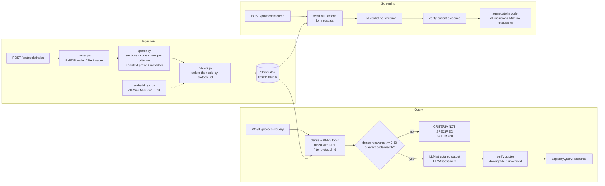

# clinical-trial-rag

[](https://github.com/kaustubh2708/clinical-trial-rag/actions/workflows/ci.yml) [](LICENSE)

A FastAPI microservice that answers eligibility questions about clinical trial protocols, and pre-screens a patient summary against every criterion of a trial. Answers are grounded in verbatim, verified protocol text.

Built with FastAPI, LangChain, ChromaDB, sentence-transformers and Pydantic v2. Runs with OpenAI, or fully locally with Ollama (e.g. Qwen).

> **Decision support only.** Not a validated medical device. A qualified research coordinator makes every enrolment decision. Use public or synthetic protocols and de-identified patient text only.

**New to the stack?** [`docs/STUDY_BOOK.md`](docs/STUDY_BOOK.md) is an 18-chapter guide to every concept and file in this repo, from the clinical-trials primer to the code walkthrough, evaluation and interview questions.

## Design in one paragraph

The LLM only reads text and fills a typed form. Code handles everything else:
- trial isolation (a hard `protocol_id` filter inside the vector query)
- hybrid retrieval (dense embeddings + BM25 keyword search, fused with Reciprocal Rank Fusion)
- abstention (a relevance gate that skips the LLM call)
- the fixed fallback sentence
- verbatim quote verification, which computes `is_grounded`
- the final eligible / not-eligible decision

Every response carries an audit block (model, prompt version, retrieval mode, chunk IDs, context hash), so any answer can be traced and replayed.

## Architecture



| Endpoint | Purpose |
| --- | --- |
| `POST /api/v1/protocols/index` | Upload a `.pdf`/`.txt` protocol (`multipart/form-data`: `file`, `protocol_id`). Re-uploading replaces the old version |
| `POST /api/v1/protocols/query` | Criterion Q&A, top-k RAG with citations |
| `POST /api/v1/protocols/screen` | Check a patient summary against every inclusion/exclusion criterion |
| `GET /api/v1/protocols` | List indexed protocols |
| `DELETE /api/v1/protocols/{protocol_id}` | Remove a protocol |
| `GET /health` / `GET /ready` | Liveness / readiness |

Interactive docs: `http://localhost:8000/docs`.

## Quickstart

```bash
python3.11 -m venv .venv && source .venv/bin/activate
pip install torch==2.14.1 --index-url https://download.pytorch.org/whl/cpu
pip install -r requirements.txt
cp .env.example .env          # add OPENAI_API_KEY for LLM answers
uvicorn app:app --reload --port 8000
```

Without an API key you can still index, list and delete protocols. Queries that the relevance gate blocks still work too. Endpoints that need the LLM return `503`.

## Run with a local model (Ollama + Qwen)

No API key, and protocol and patient text never leave your machine. The code path is the same; only the model client changes (`get_llm()` in `src/api/dependencies.py`).

```bash
# 1. Install Ollama (https://ollama.com/download), then pull a Qwen model
ollama pull qwen2.5:7b

# 2. Point the service at it (or put these lines in .env)
export LLM_PROVIDER=ollama
export LLM_MODEL_NAME=qwen2.5:7b
export LLM_TIMEOUT_SECONDS=600        # CPU inference is slow
export MAX_SCREENING_CRITERIA=1       # one call per criterion: more reliable for small models
uvicorn app:app --port 8000

curl http://localhost:8000/ready      # {"llm_provider": "ollama", "llm_model": "qwen2.5:7b", ...}
```

From Docker, reach Ollama on the host with `-e OLLAMA_BASE_URL=http://host.docker.internal:11434 --add-host=host.docker.internal:host-gateway`. On Linux, also start Ollama with `OLLAMA_HOST=0.0.0.0` so it accepts connections from the container.

Settings that matter for local models:

| Setting | Default | Why |
| --- | --- | --- |
| `OLLAMA_NUM_CTX` | 8192 | Ollama's context window. A prompt longer than this is truncated, so part of the instructions or criteria can silently go missing |
| `LLM_MAX_OUTPUT_TOKENS` | 2048 | Caps generation. Without a cap, a 3B model looped for 6,000+ tokens on one answer |
| `MAX_SCREENING_CRITERIA` | 80 | Criteria per LLM call. Set to 1 for small models |

Choosing a model: structured output with verbatim quotes needs roughly 7B parameters or more. `qwen2.5:3b` repeatedly looped inside its quotes, so every answer was correctly rejected by quote verification but none were useful. `qwen3:8b` and larger also work; Qwen3-family models "think" before answering, which is slower on CPU.

What testing on `qwen2.5:7b` (4-core CPU, no GPU) showed:

| Measure | Result |
| --- | --- |
| Status accuracy, 18 labelled questions | 0.72 (13/18); every miss was a cautious `INDETERMINATE` |
| Unsafe answers (`ELIGIBLE` when a criterion rules the patient out) | 0 |
| Quotes verified verbatim against the protocol | 28/28 |
| Off-topic questions | 5/5 abstained without calling the model |
| Time per answer | about 29 s (median of 30 calls) |
| Patient screening, 16 criteria | about 4 min; per-criterion mode caught the eGFR exclusion that one-call mode missed |

Full output: [`eval/results_ollama_qwen2.5-7b.md`](eval/results_ollama_qwen2.5-7b.md). Running on a real model exposed several failure modes, each now handled in code:
- **Runaway generation**: a 3B model looped for 6,000+ tokens. Output is capped, and every schema field has a length limit.
- **Citation markers in quotes**: models pasted `[chunk id]` into quotes. Our own ID markers are now ignored during verification; any other extra text still fails.
- **Misaligned verdicts**: with 32-character IDs, a 7B model attached verdicts to the wrong criteria. The model now sees short labels (`I1`, `E3`) that code maps back.
- **Irrelevant evidence**: "No history of pancreatitis" was cited for pregnancy. Evidence must now share a term with its criterion.
- **Confident wrong eligibility**: two washout questions came back `ELIGIBLE` with valid quotes. A Q&A answer can now rule a patient out but never in; only `/protocols/screen` checks every criterion.

What is still not solved: small models make arithmetic mistakes on thresholds and time windows (one screening run judged "metformin 2000 mg" as failing "at least 1500 mg"). Results are decision support for a human reviewer, never a final answer.

## Example requests

Index a protocol (two synthetic samples ship in `data/sample_protocols/`):

```bash
curl -X POST http://localhost:8000/api/v1/protocols/index \
  -F "file=@data/sample_protocols/NCT90000001_t2d_protocol.txt" \
  -F "protocol_id=NCT90000001"
```

```json
{"message": "Protocol indexed successfully.", "protocol_id": "NCT90000001",
 "source_filename": "NCT90000001_t2d_protocol.txt", "chunks_indexed": 21,
 "criteria_indexed": 16, "replaced_existing": false}
```

Ask a question:

```bash
curl -X POST http://localhost:8000/api/v1/protocols/query \
  -H "Content-Type: application/json" \
  -d '{"query": "Can a patient with an eGFR of 25 enroll?", "protocol_id": "NCT90000001", "top_k": 4}'
```

Response shape (LLM wording varies):

```json
{
  "protocol_id": "NCT90000001",
  "query": "Can a patient with an eGFR of 25 enroll?",
  "status": "NOT_ELIGIBLE",
  "assessment": "STATUS: NOT_ELIGIBLE\nAn eGFR of 25 is below the exclusion threshold of 30.\n\nPROTOCOL EVIDENCE:\n- [Exclusion Criteria | 3f9c...] \"eGFR) below 30 mL/min/1.73m2 at screening\" (verified)\n\nSAFETY CONCERNS:\n- Severe renal impairment is an exclusion criterion.",
  "citations": [{"source_document": "NCT90000001_t2d_protocol.txt", "protocol_id": "NCT90000001",
                 "excerpt": "Estimated glomerular filtration rate (eGFR) below 30 mL/min/1.73m2 at screening.",
                 "chunk_id": "3f9c...", "section": "Exclusion Criteria", "criterion_type": "exclusion",
                 "quote": "eGFR) below 30 mL/min/1.73m2 at screening", "quote_verified": true}],
  "is_grounded": true,
  "safety_concerns": ["Severe renal impairment is an exclusion criterion."],
  "audit": {"model": "gpt-4o-mini", "prompt_version": "qa-v2", "retrieved_chunk_ids": ["3f9c...", "..."],
            "context_hash": "9b1e...", "llm_called": true, "timestamp": "2026-10-22T08:00:00Z"}
}
```

An off-topic question (e.g. "Where should visitors park?") returns status `CRITERIA_NOT_SPECIFIED` with exactly: *"CRITERIA NOT SPECIFIED: The provided protocol documents do not contain explicit rules regarding this query."* No LLM call is made.

Screen a patient:

```bash
curl -X POST http://localhost:8000/api/v1/protocols/screen \
  -H "Content-Type: application/json" \
  -d '{"protocol_id": "NCT90000001", "patient_summary": "62-year-old man, type 2 diabetes for 8 years, metformin 2000 mg daily, HbA1c 8.1%, BMI 31, eGFR 24 mL/min/1.73m2."}'
```

This returns one verdict per criterion (`MET` / `NOT_MET` / `INSUFFICIENT_INFO`), `failing_criteria`, `unresolved_criteria`, and an overall status computed in code.

Use a real trial: `python -m scripts.fetch_ctgov NCT04368728` writes its eligibility text from the ClinicalTrials.gov API to `data/raw_protocols/`, ready to upload.

## Guardrails

| Risk | Control |
| --- | --- |
| Cross-trial contamination | `{"protocol_id": ...}` filter inside Chroma, plus a post-filter check and a two-trial integration test |
| Lost inclusion/exclusion context | One chunk per criterion, `criterion_type` metadata, a `[NCT... \| Section]` prefix on every chunk |
| Answering out of scope | Relevance gate (`MIN_RELEVANCE_SCORE`) skips the LLM; fixed fallback string. Short code queries such as "MEN2" pass only if the code appears verbatim in the protocol |
| Hallucinated evidence | Structured output with length limits; quotes must match the cited chunk verbatim (normalised) or the status is downgraded to `INDETERMINATE` |
| Confident wrong eligibility | Q&A sees only top-k criteria, so it never returns `ELIGIBLE` (downgraded to `INDETERMINATE`); only screening can confirm eligibility |
| Missed exclusion in screening | All criteria fetched by metadata, not top-k; short labels the model can copy; patient evidence must be verbatim and mention the criterion; missing verdicts become `INSUFFICIENT_INFO`; AND/ANY logic in code |
| Prompt injection in documents | Delimiter tags stripped from document text; "data, not instructions" rule; no tools |
| Bad uploads | Extension and `%PDF` magic-byte check, size limit (413), empty-text and corrupt-file rejection (422), non-UTF-8 text decoded, filename sanitising. Files are staged and kept only if ingestion succeeds, so a failed re-upload never replaces the previous version |
| PHI in logs | Only SHA-256 fingerprints of query or patient text are logged |

## Evaluation

`python -m eval.run_eval` indexes the sample protocols with the real embedding model and runs `eval/golden_set.jsonl`: 20 paraphrased questions, 10 exact-term queries (codes and acronyms such as "CYP3A4" or "MEN2") and 5 out-of-scope questions. It compares dense-only and hybrid retrieval and sweeps the abstention threshold; full output is in [`eval/results.md`](eval/results.md). Add `--with-llm` to also measure status accuracy, unsafe answers, citation verification rate and grounded rate with a real model (OpenAI, or local Ollama; results for `qwen2.5:7b` are in the Ollama section above).

| Retrieval (top_k=4) | Dense only | Hybrid (default) |
| --- | --- | --- |
| Hit rate @4 (30 answerable) | 0.97 | 0.97 |
| MRR, paraphrased / exact-term | 0.97 / 0.90 | 0.97 / 0.90 |
| Contamination rate | 0.00 | 0.00 |
| Off-topic blocked @ gate 0.30 | 1.00 | 1.00 |
| Answerable wrongly blocked @ gate 0.30 | 0.07 | 0.03 |

What the numbers say, honestly:
- On this small corpus, MiniLM already ranks exact terms well, so hybrid fusion does not change MRR. It fixes one question ("liver enzyme limits", rank 3 → 1) and costs one ("age range", rank 1 → 3).
- The gain is at the gate: dense-only abstained on short acronym queries ("MEN2 history" scored 0.291). Hybrid lets a query through when a code it names appears verbatim in the protocol, halving false abstentions without letting any off-topic question through.
- The remaining miss is "ANC threshold": the protocol says "absolute neutrophil count", so neither ranker can match it. Abbreviation expansion is on the roadmap.
- Hybrid is the default for robustness on long real-world criteria: MiniLM reads at most 256 tokens per chunk, while BM25 sees the full text.
- 35 synthetic cases is a smoke test. Grow the set with real ClinicalTrials.gov trials before trusting the threshold.

## Development and tests

```bash
pip install torch==2.14.1 --index-url https://download.pytorch.org/whl/cpu
pip install -r requirements-dev.txt
ruff check .      # lint (config in pyproject.toml)
mypy              # type check src/
pytest            # 116 tests, offline, ~4 s: fake embeddings + fake LLM, temp Chroma per test
pytest -m slow    # 3 tests with the real MiniLM model
python -m eval.run_eval --min-hit-rate 0.95   # retrieval eval; exits 1 below the floor
LLM_PROVIDER=ollama LLM_MODEL_NAME=qwen2.5:7b python -m eval.run_eval --with-llm --limit 10
```

- Unit tests cover schemas, the splitter, guardrails, BM25/RRF and chain logic.
- Integration tests cover every endpoint: two-trial isolation, re-index idempotency, real and corrupt PDFs, non-UTF-8 text, failed re-uploads, upload limits and prompt injection.
- GitHub Actions (`.github/workflows/ci.yml`) runs lint, type checks, all tests, the retrieval eval with a hit-rate floor, and a Docker build on every push.

## Docker

```bash
docker build -t clinical-trial-rag .
docker run -p 8000:8000 --env-file .env -v "$(pwd)/data:/app/data" clinical-trial-rag
```

- Multi-stage build with CPU-only torch.
- The embedding model is baked into the image, so it runs offline.
- Runs as the non-root user `gskapp`, with a Python-based `HEALTHCHECK` on `/health`.
- Single worker, because local Chroma is single-process.

## Project layout

```
src/config.py              settings (pydantic-settings)
src/schemas.py             API + LLM structured-output schemas
src/ingestion/parser.py    PDF/TXT -> Documents
src/ingestion/splitter.py  section-aware, criterion-level chunking
src/ingestion/indexer.py   idempotent Chroma writes, criteria lookup, ingest_file()
src/rag/embeddings.py      MiniLM singleton
src/rag/prompt_templates.py versioned prompts, context formatting
src/rag/guardrails.py      quote verification, sanitising, log hashing
src/rag/hybrid.py          BM25, code/acronym detection, Reciprocal Rank Fusion
src/rag/chain.py           query + screening pipelines, aggregation
src/api/dependencies.py    DI providers (overridden in tests)
src/api/routes.py          endpoints
eval/                      golden set + harness
scripts/fetch_ctgov.py     pull real eligibility criteria
docs/STUDY_BOOK.md         study guide for the whole project
.github/workflows/ci.yml   CI pipeline
pyproject.toml             ruff, mypy and pytest configuration
```

## Data and sources

- **Sample protocols** (`data/sample_protocols/`): two synthetic protocols written for this project, with made-up IDs `NCT90000001` and `NCT90000002`. They are not real studies and contain no patient data.
- **Evaluation set** (`eval/golden_set.jsonl`): 35 questions written for this project against the sample protocols.
- **Real trials**: `scripts/fetch_ctgov.py` downloads public eligibility criteria from the [ClinicalTrials.gov API v2](https://clinicaltrials.gov/data-api/about-api) (no key needed). Nothing downloaded is committed.
- **Embedding model**: [sentence-transformers/all-MiniLM-L6-v2](https://huggingface.co/sentence-transformers/all-MiniLM-L6-v2) (Apache-2.0), downloaded from Hugging Face at install or build time.
- **Methods**: [RAG](https://arxiv.org/abs/2005.11401) (Lewis et al., 2020), [Sentence-BERT](https://arxiv.org/abs/1908.10084) (Reimers & Gurevych, 2019), [HNSW](https://arxiv.org/abs/1603.09320) (Malkov & Yashunin), [BM25](https://nowpublishers.com/article/Details/INR-019) (Robertson & Zaragoza, 2009), [Reciprocal Rank Fusion](https://plg.uwaterloo.ca/~gvcormac/cormacksigir09-rrf.pdf) (Cormack et al., SIGIR 2009), and per-criterion screening as in [TrialGPT](https://doi.org/10.1038/s41467-024-53081-z) (Jin et al., Nature Communications 2024).

The [study book](docs/STUDY_BOOK.md#data-and-sources) lists every source it relies on.

## Roadmap

- Abbreviation expansion for clinical acronyms (ANC → absolute neutrophil count). A cross-encoder re-ranker. Weighted RRF, tuned on a larger eval set.
- Biomedical embeddings (e.g. `bge-small-en-v1.5` or PubMedBERT variants), compared on a larger eval set.
- PHI de-identification before the LLM call. Azure OpenAI or a private model endpoint.
- Async ingestion queue. Chroma server or pgvector for multiple replicas.
- Authentication and per-study access control. An append-only audit store.

## License

[MIT](LICENSE)
